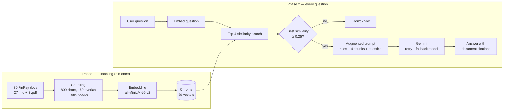
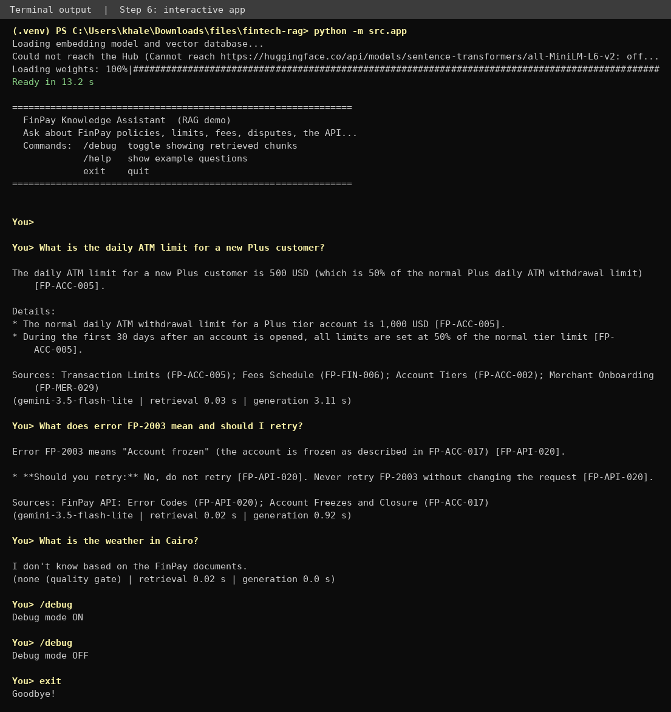

# FinPay Knowledge Assistant — a RAG System for Fintech Policies

A Retrieval-Augmented Generation (RAG) system that answers questions about the
internal policies of **FinPay**, a fictional digital payments company. It
retrieves the most relevant passages from 30 policy documents and asks an LLM
to answer **only** from those passages, with a citation for every fact — and to
say *"I don't know"* when the documents do not contain the answer.

Built for the *Computers and Society* course assignment
"Building and Demystifying Retrieval-Augmented Generation (RAG) Systems".

---

## Tech stack

| Layer | Choice | Why |
|---|---|---|
| Language | Python 3.12 | Largest RAG ecosystem and documentation |
| Orchestration | LangChain (`langchain-core`, `langchain-text-splitters`) | Standard building blocks: splitter, prompt template, vector-store interface |
| Embeddings | `sentence-transformers/all-MiniLM-L6-v2` (local) | Free, runs on CPU, documents never leave the machine; 384-dimension vectors |
| Vector database | Chroma (persistent, cosine distance, HNSW index) | Embedded, no server to run, saves to a local folder |
| LLM | Google Gemini `gemini-3.5-flash-lite` via `langchain-google-genai` | Free tier, fast; fallback model configurable |
| Secrets | `python-dotenv` + `.env` (git-ignored) | API key is never in the code or the repository |

---

## Architecture



Hallucination is controlled in **two layers**:
1. **Similarity gate** — if no chunk is similar enough (off-topic question), the
   LLM is never called.
2. **Grounding prompt** — the LLM must use only the provided context, cite the
   document ID for every fact, and reply *"I don't know based on the FinPay
   documents."* when the context does not answer the question.

---

## Project structure

```
fintech-rag/
├── data/raw/              # 30 FinPay policy documents (dataset)
├── src/
│   ├── config.py          # all settings in one place (chunk size, top-k, models...)
│   ├── ingest.py          # Steps 2-3: load, chunk, embed, store in Chroma
│   ├── vectorstore.py     # embedding model + Chroma connection
│   ├── retriever.py       # Step 4: similarity search + quality gate
│   ├── generator.py       # Step 5: prompt template, Gemini call, retry/fallback
│   ├── app.py             # Step 6: interactive command-line assistant
│   ├── evaluate.py        # Step 7: evaluation + chunk-size experiment
│   └── embeddings_demo.py # small experiment showing cosine similarity
├── eval/
│   ├── test_set.json      # 22 labelled test questions
│   ├── summary.md         # evaluation results (generated)
│   ├── results.csv        # per-question results (generated)
│   └── chunk_experiment.md
├── evidence/
│   ├── run_log.md         # real terminal output of every step
│   └── screenshots/       # figures used in the report
├── check_setup.py         # verifies installation and API key
├── requirements.txt
└── .env.example           # template for your own .env
```

---

## How to run

### 1. Prerequisites
- Python **3.10+** (developed with 3.12)
- A free Google Gemini API key from <https://aistudio.google.com/apikey>

### 2. Install
```bash
git clone https://github.com/<your-username>/fintech-rag.git
cd fintech-rag
python -m venv .venv
# Windows:
.venv\Scripts\activate
# macOS / Linux:
source .venv/bin/activate

# CPU-only PyTorch (much smaller download), then the project dependencies
pip install torch --index-url https://download.pytorch.org/whl/cpu
pip install -r requirements.txt
```

### 3. Configure your API key
```bash
# Windows
copy .env.example .env
# macOS / Linux
cp .env.example .env
```
Open `.env` and replace `your_gemini_api_key_here` with your key. Then check:
```bash
python check_setup.py
```

### 4. Build the vector database
```bash
python -m src.ingest            # first run downloads the embedding model (~90 MB)
python -m src.ingest --preview  # optional: chunking statistics only
```

### 5. Ask questions
```bash
python -m src.app               # interactive assistant (/debug shows retrieved chunks)
```
Other entry points:
```bash
python -m src.retriever "How long do I have to dispute a card payment?"   # retrieval only
python -m src.generator "What does error FP-2003 mean?"                  # one full answer
python -m src.embeddings_demo                                            # similarity demo
```

### 6. Evaluate
```bash
python -m src.evaluate --retrieval-only   # retrieval metrics, no API calls
python -m src.evaluate --judge            # full evaluation + LLM-as-judge
python -m src.evaluate --chunk-experiment # compare chunk sizes, no API calls
```

---

## Example

```
You> What is the daily ATM limit for a new Plus customer?

The daily ATM limit for a new Plus customer is 500 USD (which is 50% of the normal
Plus daily ATM withdrawal limit) [FP-ACC-005].

Details:
* The normal daily ATM withdrawal limit for a Plus tier account is 1,000 USD [FP-ACC-005].
* During the first 30 days after an account is opened, all limits are set at 50% of
  the normal tier limit [FP-ACC-005].

Sources: Transaction Limits (FP-ACC-005); Fees Schedule (FP-FIN-006); ...
(gemini-3.5-flash-lite | retrieval 0.03 s | generation 3.11 s)

You> What is the weather in Cairo?

I don't know based on the FinPay documents.
(none (quality gate) | retrieval 0.02 s | generation 0.0 s)
```



---

## Evaluation results

Test set: 22 questions — 17 answerable, 3 unanswerable but on-topic
(e.g. *"Who is the CEO of FinPay?"*), 2 off-topic.

| Metric | Result |
|---|---|
| Retrieval Hit@1 | 0.94 (16/17) |
| Retrieval Hit@4 | 1.00 |
| Retrieval MRR | 0.97 |
| Answer correctness | 17/17 |
| Correct refusals (unanswerable + off-topic) | 5/5 |
| Faithfulness (LLM-as-judge) | 17/17 |
| Retrieval latency | ~0.02 s |
| Generation latency | ~1–5 s (varies with Gemini load) |

Chunk-size experiment (retrieval only):

| Chunk size / overlap | Chunks | Hit@1 | Hit@4 | MRR |
|---|---|---|---|---|
| 300 / 50 | 212 | 0.94 | 1.00 | 0.97 |
| 500 / 100 | 123 | 1.00 | 1.00 | 1.00 |
| **800 / 150 (used)** | 80 | 0.94 | 1.00 | 0.97 |
| 1200 / 200 | 57 | 0.88 | 1.00 | 0.93 |
| 2000 / 300 | 30 | 0.94 | 1.00 | 0.97 |

**Key findings**
- Unanswerable questions scored a *higher* best-similarity (0.51–0.57) than the
  weakest answerable question (0.40), so a similarity threshold alone cannot
  detect missing answers; the grounding prompt is what caught all three.
- Off-topic questions scored 0.07–0.09, far below the 0.25 gate.
- The single Hit@1 miss (merchant vs. customer chargeback policy) was still
  answered correctly because top-4 retrieval included the right chunk.

**Limitations:** small test set written by the same author as the documents;
keyword-based correctness check; the faithfulness judge is the same model
family as the generator. See the technical report for the full analysis.

---

## Dataset

The 30 documents in `data/raw/` describe a **fictional** company and were written
for this project (no real company data). Because FinPay does not exist, the LLM
cannot know these facts from its training data — every correct answer
demonstrates retrieval, not memorisation.

## Configuration

All tunable values are in `src/config.py` (chunk size, overlap, top-k, similarity
threshold, retries). Model names can be changed in `.env` without touching code.
