# FinPay RAG — Run Log (evidence)

Real terminal output from building and testing the system on a Windows laptop
(Python 3.12, VS Code), collected step by step. Progress bars and repeated
library warnings are trimmed; everything else is as printed.

## Figures (screenshots folder)

The images in `evidence/screenshots/` are rendered directly from the saved
terminal log of these runs (cropped to the relevant lines; long tracebacks
shortened where marked `[... traceback lines omitted ...]`).

| Figure | Shows |
|---|---|
| 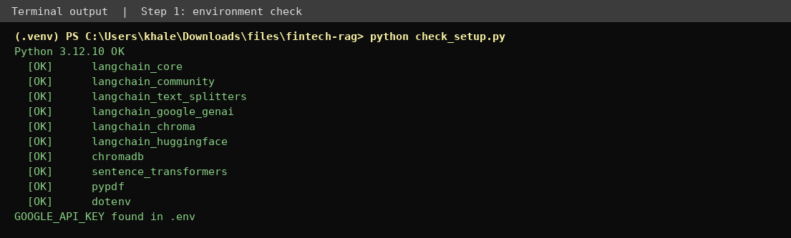 **Fig 1** | Environment check: all libraries installed, API key found |
| 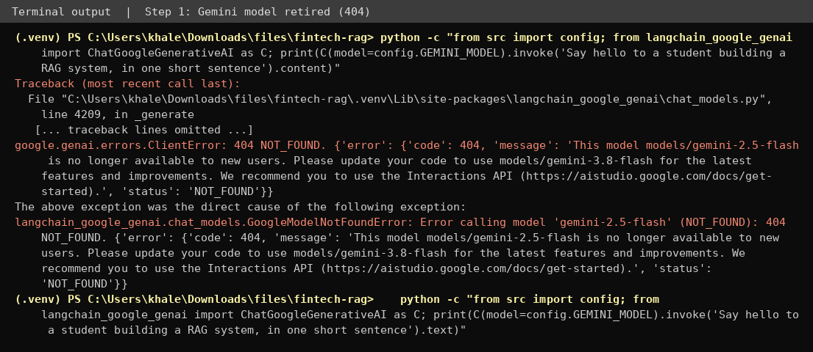 **Fig 2** | Gemini 2.5 Flash retired for new users (HTTP 404) |
| 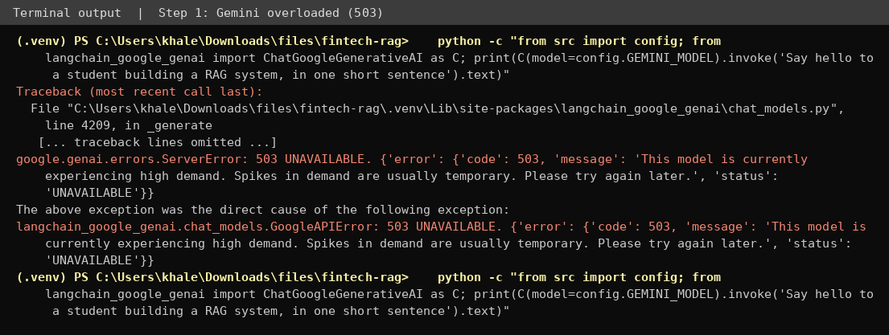 **Fig 3** | Gemini 3.8 Flash overloaded (HTTP 503) |
| 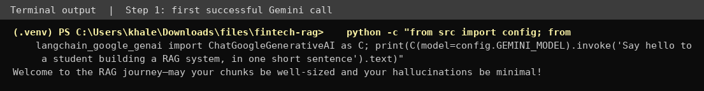 **Fig 4** | First successful Gemini call (gemini-3.5-flash-lite) |
| 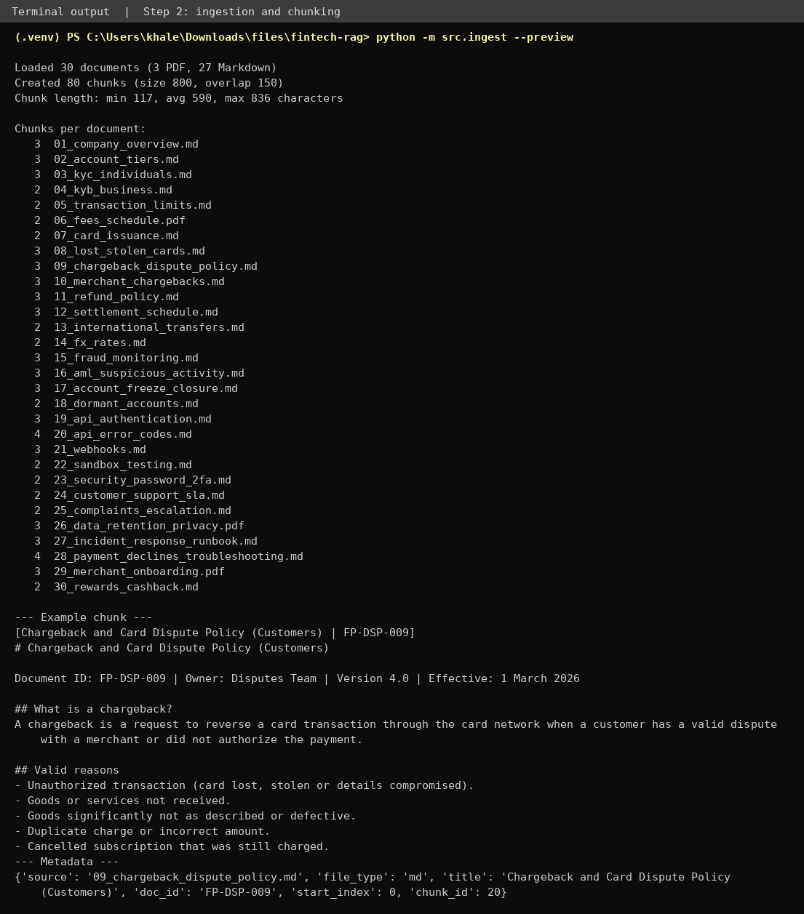 **Fig 5** | Ingestion and chunking: 30 documents, 80 chunks |
| 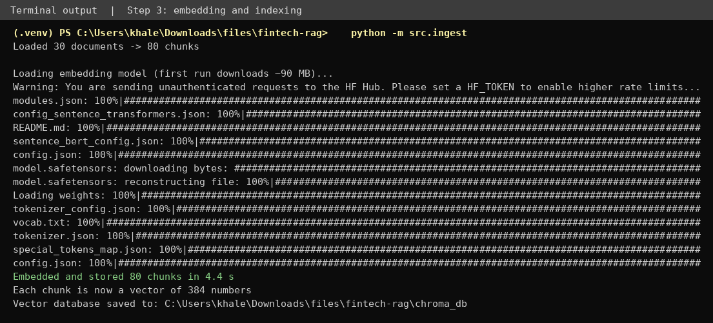 **Fig 6** | Embedding and indexing into Chroma |
| 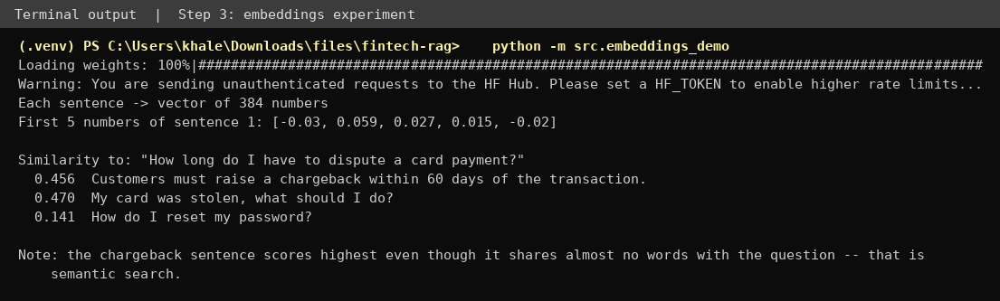 **Fig 7** | Embeddings experiment (cosine similarity) |
| 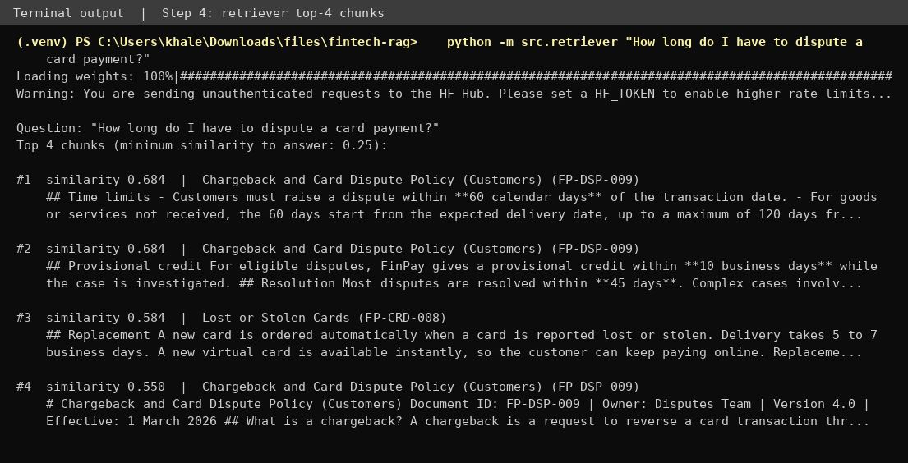 **Fig 8** | Retriever: top-4 chunks with similarity scores |
| 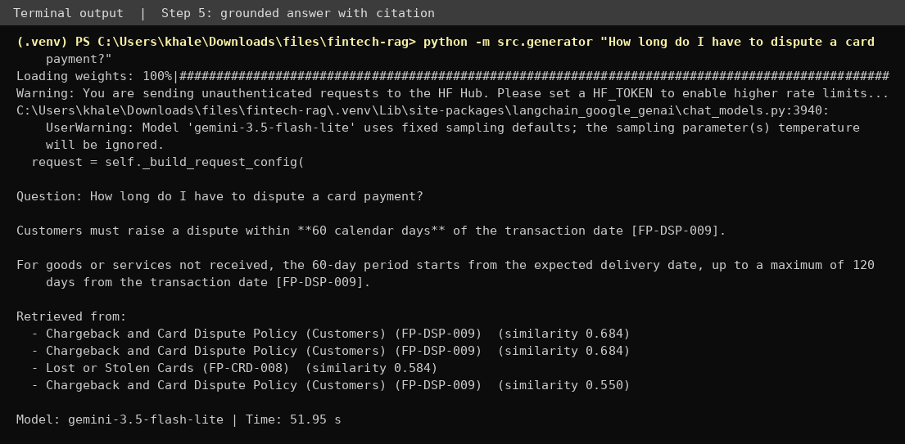 **Fig 9** | Grounded answer with citations |
| 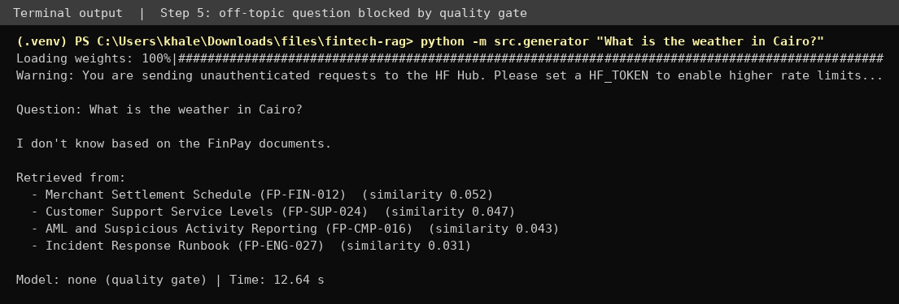 **Fig 10** | Off-topic question blocked by the quality gate |
| 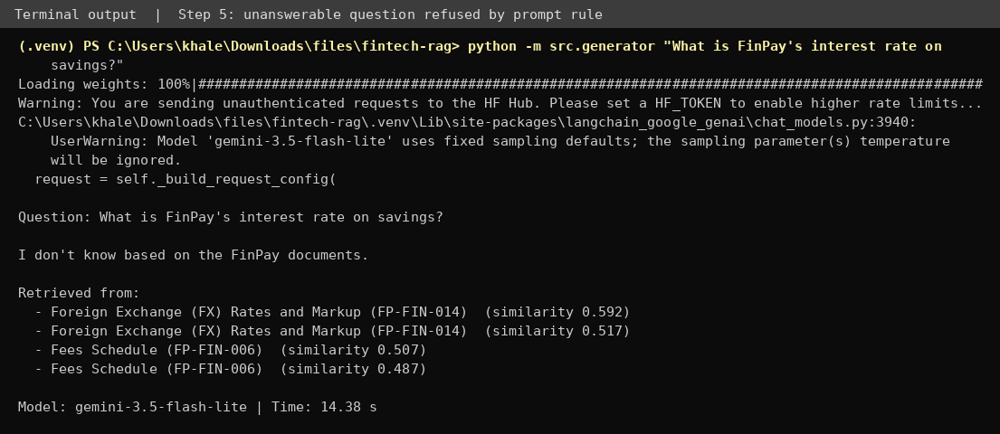 **Fig 11** | Unanswerable question refused by the prompt rule |
| 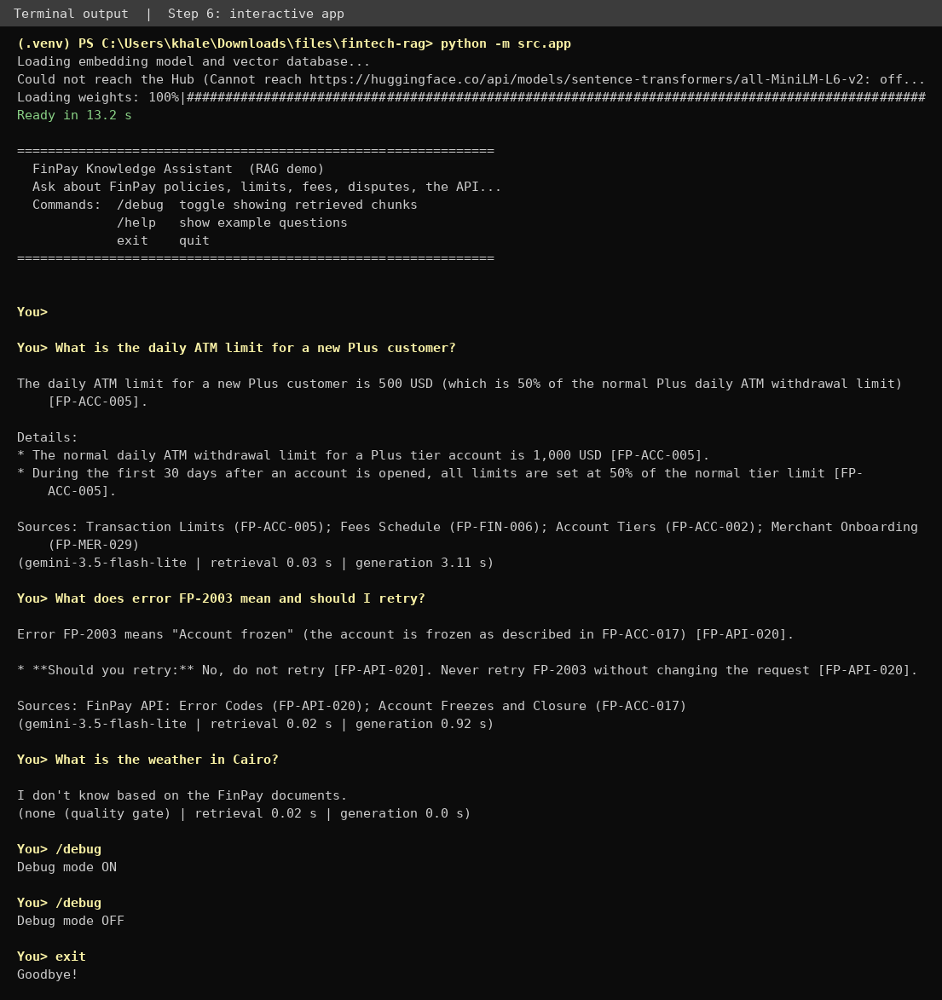 **Fig 12** | Interactive app: multi-fact answer, error code, off-topic |
| 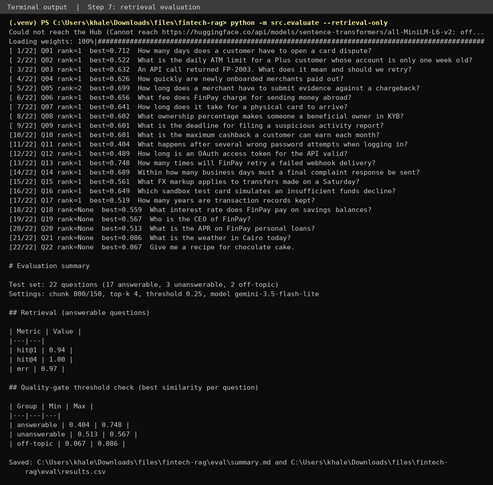 **Fig 13** | Retrieval evaluation (Hit@1, Hit@4, MRR) |
| 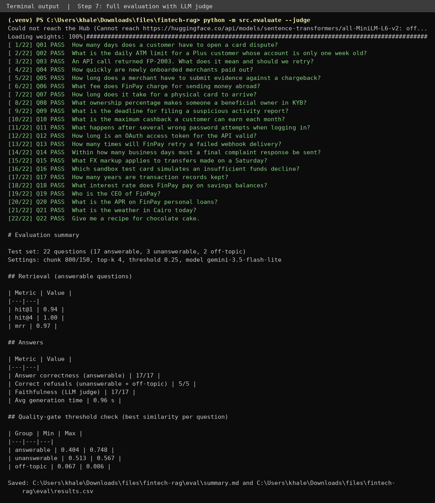 **Fig 14** | Full evaluation with LLM-as-judge faithfulness |
| 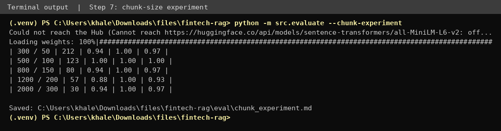 **Fig 15** | Chunk-size experiment |

---

## Step 1 — Environment setup: problems found and fixed

### 1.0 Environment check (Fig 1)
`python check_setup.py`
```
Python 3.12.10 OK
  [OK]      langchain_core
  [OK]      langchain_community
  [OK]      langchain_text_splitters
  [OK]      langchain_google_genai
  [OK]      langchain_chroma
  [OK]      langchain_huggingface
  [OK]      chromadb
  [OK]      sentence_transformers
  [OK]      pypdf
  [OK]      dotenv
GOOGLE_API_KEY found in .env
```

### 1.1 Slow / unstable network during installation
The first `pip install langchain-google-genai` failed with repeated
`NewConnectionError` retries, and a later attempt ended in
`ReadTimeoutError: HTTPSConnectionPool(host='files.pythonhosted.org') Read timed out.`
Downloads ran at ~30–50 kB/s. **Fix:** retried with
`pip install --timeout 120 --retries 10 ...`, which succeeded.

### 1a. Groq API key could not be created
The Groq console disabled the "Create API Key" button with the message:
"Only team owners or users with the developer role may create or manage API keys."
This is a known issue with some new Groq accounts. **Decision:** switch the
generation provider to Google Gemini (free tier). Only `requirements.txt`,
`config.py` and `.env` changed — the rest of the pipeline was untouched.

### 1b. Gemini model retired (HTTP 404)
```
google.genai.errors.ClientError: 404 NOT_FOUND. {'error': {'code': 404, 'message':
'This model models/gemini-2.5-flash is no longer available to new users. Please update
your code to use models/gemini-3.8-flash ...', 'status': 'NOT_FOUND'}}
```
**Fix:** one-line change of `GEMINI_MODEL` in `.env` (no code change needed,
because the model name is configuration, not hard-coded).

### 1c. Gemini model overloaded (HTTP 503)
```
google.genai.errors.ServerError: 503 UNAVAILABLE. {'error': {'code': 503, 'message':
'This model is currently experiencing high demand. Spikes in demand are usually
temporary. Please try again later.', 'status': 'UNAVAILABLE'}}
```
**Fix:** switched to `gemini-3.5-flash-lite`, and later added retry with
exponential backoff + automatic fallback model in `src/generator.py`.

### 1d. First successful call (Fig 4)
```
Welcome to the RAG journey—may your chunks be well-sized and your hallucinations be minimal!
```

---

## Step 2 — Ingestion and chunking
`python -m src.ingest --preview`
```
Loaded 30 documents (3 PDF, 27 Markdown)
Created 80 chunks (size 800, overlap 150)
Chunk length: min 117, avg 590, max 836 characters

Chunks per document:
   3  01_company_overview.md
   3  02_account_tiers.md
   3  03_kyc_individuals.md
   2  04_kyb_business.md
   2  05_transaction_limits.md
   2  06_fees_schedule.pdf
   2  07_card_issuance.md
   3  08_lost_stolen_cards.md
   3  09_chargeback_dispute_policy.md
   3  10_merchant_chargebacks.md
   3  11_refund_policy.md
   3  12_settlement_schedule.md
   2  13_international_transfers.md
   2  14_fx_rates.md
   3  15_fraud_monitoring.md
   3  16_aml_suspicious_activity.md
   3  17_account_freeze_closure.md
   2  18_dormant_accounts.md
   3  19_api_authentication.md
   4  20_api_error_codes.md
   3  21_webhooks.md
   2  22_sandbox_testing.md
   2  23_security_password_2fa.md
   2  24_customer_support_sla.md
   2  25_complaints_escalation.md
   3  26_data_retention_privacy.pdf
   3  27_incident_response_runbook.md
   4  28_payment_declines_troubleshooting.md
   3  29_merchant_onboarding.pdf
   2  30_rewards_cashback.md

--- Example chunk ---
[Chargeback and Card Dispute Policy (Customers) | FP-DSP-009]
# Chargeback and Card Dispute Policy (Customers)

Document ID: FP-DSP-009 | Owner: Disputes Team | Version 4.0 | Effective: 1 March 2026

## What is a chargeback?
A chargeback is a request to reverse a card transaction through the card network when
a customer has a valid dispute with a merchant or did not authorize the payment.

## Valid reasons
- Unauthorized transaction (card lost, stolen or details compromised).
- Goods or services not received.
- Goods significantly not as described or defective.
- Duplicate charge or incorrect amount.
- Cancelled subscription that was still charged.
--- Metadata ---
{'source': '09_chargeback_dispute_policy.md', 'file_type': 'md', 'title': 'Chargeback and
Card Dispute Policy (Customers)', 'doc_id': 'FP-DSP-009', 'start_index': 0, 'chunk_id': 20}
```

---

## Step 3 — Embedding and indexing
`python -m src.ingest`
```
Loaded 30 documents -> 80 chunks
Loading embedding model (first run downloads ~90 MB)...
Embedded and stored 80 chunks in 4.4 s
Each chunk is now a vector of 384 numbers
Vector database saved to: C:\Users\khale\Downloads\files\fintech-rag\chroma_db
```

### Embeddings experiment
`python -m src.embeddings_demo` (first version)
```
Each sentence -> vector of 384 numbers
First 5 numbers of sentence 1: [-0.03, 0.059, 0.027, 0.015, -0.02]

Similarity to: "How long do I have to dispute a card payment?"
  0.456  Customers must raise a chargeback within 60 days of the transaction.
  0.470  My card was stolen, what should I do?
  0.141  How do I reset my password?
```
**Finding:** both card-related sentences score ~3x higher than the password
sentence (semantic grouping works), but the small model ranks the "stolen card"
sentence slightly above the real answer because of the shared word "card".
This motivates retrieving top-k = 4 instead of top-1.

---

## Step 4 — Retriever
`python -m src.retriever "How long do I have to dispute a card payment?"`
```
Top 4 chunks (minimum similarity to answer: 0.25):

#1  similarity 0.684  |  Chargeback and Card Dispute Policy (Customers) (FP-DSP-009)
    ## Time limits - Customers must raise a dispute within **60 calendar days** of the
    transaction date. ...
#2  similarity 0.684  |  Chargeback and Card Dispute Policy (Customers) (FP-DSP-009)
    ## Provisional credit For eligible disputes, FinPay gives a provisional credit within
    **10 business days** ...
#3  similarity 0.584  |  Lost or Stolen Cards (FP-CRD-008)
    ## Replacement A new card is ordered automatically ...
#4  similarity 0.550  |  Chargeback and Card Dispute Policy (Customers) (FP-DSP-009)
    # Chargeback and Card Dispute Policy (Customers) ...
```

---

## Step 5 — Prompt engineering and generation
`python -m src.generator "How long do I have to dispute a card payment?"`
```
Customers must raise a dispute within **60 calendar days** of the transaction date
[FP-DSP-009].

For goods or services not received, the 60-day period starts from the expected delivery
date, up to a maximum of 120 days from the transaction date [FP-DSP-009].

Model: gemini-3.5-flash-lite | Time: 51.95 s
```

`python -m src.generator "What is the weather in Cairo?"`
```
I don't know based on the FinPay documents.

Retrieved from:
  - Merchant Settlement Schedule (FP-FIN-012)  (similarity 0.052)
  ...
Model: none (quality gate) | Time: 12.64 s
```

`python -m src.generator "What is FinPay's interest rate on savings?"`
```
I don't know based on the FinPay documents.

Retrieved from:
  - Foreign Exchange (FX) Rates and Markup (FP-FIN-014)  (similarity 0.592)
  - Foreign Exchange (FX) Rates and Markup (FP-FIN-014)  (similarity 0.517)
  - Fees Schedule (FP-FIN-006)  (similarity 0.507)
  - Fees Schedule (FP-FIN-006)  (similarity 0.487)

Model: gemini-3.5-flash-lite | Time: 14.38 s
```
**Finding:** the savings question passed the similarity gate (0.592) but the
prompt rule made Gemini refuse instead of inventing a rate — the second layer
of hallucination protection. The weather question took 12.6 s *without any LLM
call*, showing that the slow times were start-up cost (loading the model each
run), not generation. This led to the long-running app in Step 6.

---

## Step 6 — End-to-end interactive app
`python -m src.app`
```
Loading embedding model and vector database...
Ready in 13.2 s

You> What is the daily ATM limit for a new Plus customer?

The daily ATM limit for a new Plus customer is 500 USD (which is 50% of the normal Plus
daily ATM withdrawal limit) [FP-ACC-005].

Details:
* The normal daily ATM withdrawal limit for a Plus tier account is 1,000 USD [FP-ACC-005].
* During the first 30 days after an account is opened, all limits are set at 50% of the
  normal tier limit [FP-ACC-005].

Sources: Transaction Limits (FP-ACC-005); Fees Schedule (FP-FIN-006); Account Tiers
(FP-ACC-002); Merchant Onboarding (FP-MER-029)
(gemini-3.5-flash-lite | retrieval 0.03 s | generation 3.11 s)

You> What does error FP-2003 mean and should I retry?

Error FP-2003 means "Account frozen" (the account is frozen as described in FP-ACC-017)
[FP-API-020].

* **Should you retry:** No, do not retry [FP-API-020]. Never retry FP-2003 without
  changing the request [FP-API-020].

Sources: FinPay API: Error Codes (FP-API-020); Account Freezes and Closure (FP-ACC-017)
(gemini-3.5-flash-lite | retrieval 0.02 s | generation 0.92 s)

You> What is the weather in Cairo?

I don't know based on the FinPay documents.
(none (quality gate) | retrieval 0.02 s | generation 0.0 s)
```
**Finding:** loading once at start-up reduced per-question time from 12–52 s to
~1–3 s. Retrieval is ~0.02 s; the LLM call dominates latency.

---

## Step 7 — Evaluation
Full results are in `eval/summary.md`, `eval/results.csv` and
`eval/chunk_experiment.md`. Key numbers (`python -m src.evaluate --judge`):

| Metric | Result |
|---|---|
| Hit@1 | 0.94 (16/17) |
| Hit@4 | 1.00 |
| MRR | 0.97 |
| Answer correctness | 17/17 |
| Correct refusals | 5/5 |
| Faithfulness (LLM judge) | 17/17 |
| Avg generation time | 5.08 s (run 2) / 0.96 s (run 3) |

Best-similarity ranges: answerable 0.404–0.748, unanswerable 0.513–0.567,
off-topic 0.067–0.086.

Chunk-size experiment (retrieval only):

| Chunk size / overlap | Chunks | Hit@1 | Hit@4 | MRR |
|---|---|---|---|---|
| 300 / 50 | 212 | 0.94 | 1.00 | 0.97 |
| 500 / 100 | 123 | 1.00 | 1.00 | 1.00 |
| 800 / 150 | 80 | 0.94 | 1.00 | 0.97 |
| 1200 / 200 | 57 | 0.88 | 1.00 | 0.93 |
| 2000 / 300 | 30 | 0.94 | 1.00 | 0.97 |
